# AICRM SaaS

Production-grade single-tenant project management & collaboration SaaS (FastAPI + React + MySQL + Redis), built for private deployment with online upgrades.

## Screenshots / 界面截图

Captured from the seeded demo dataset (Chinese UI) — regenerate with `node scripts/capture-screenshots.mjs`
while the backend (`:8000`) and frontend (`:5173`) dev servers are running.

| Login / 登录 | Dashboard / 工作台 |
| --- | --- |
| 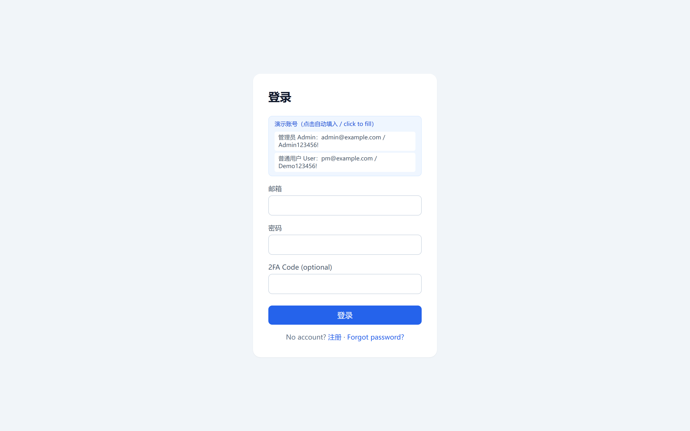 | 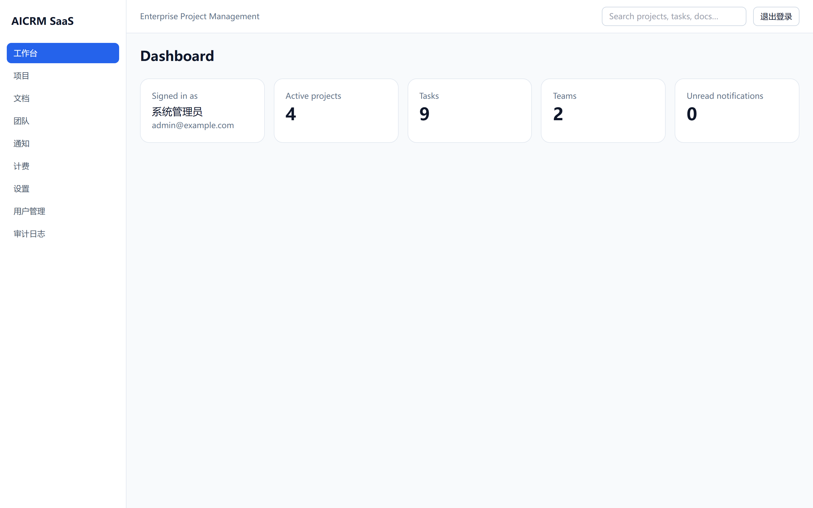 |

| Projects / 项目 | Kanban board / 迭代看板 |
| --- | --- |
| 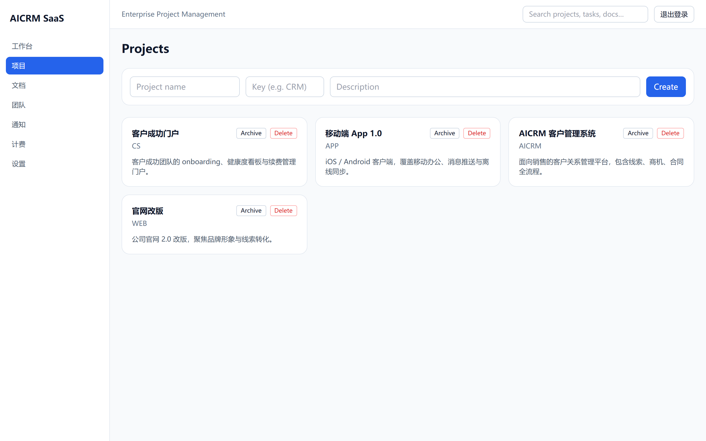 | 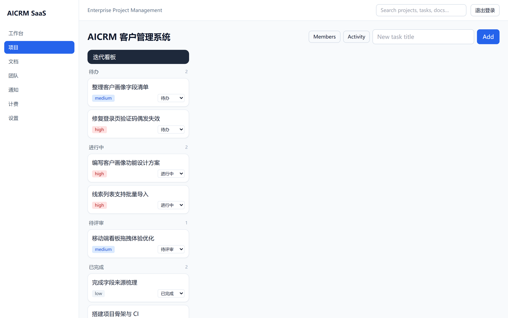 |

| Documents / 文档 | Teams / 团队 |
| --- | --- |
| 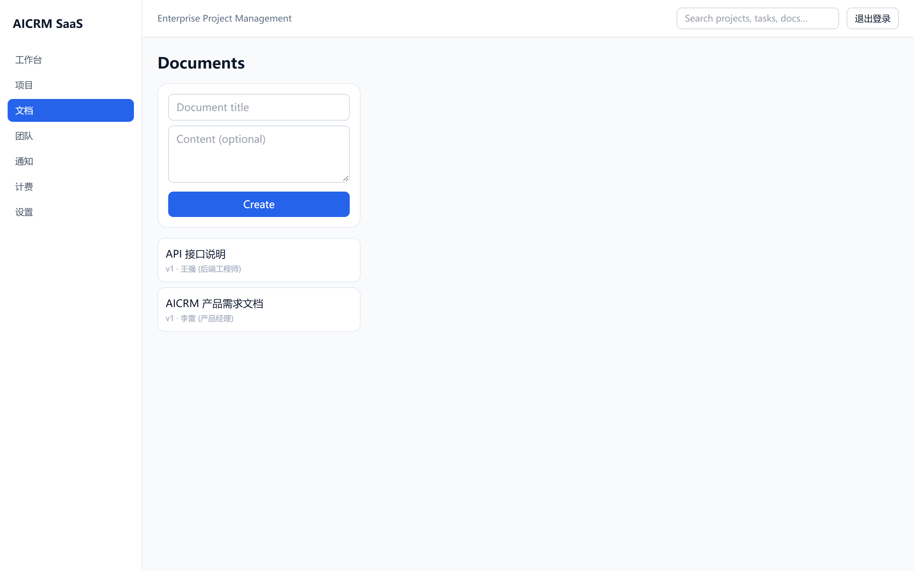 | 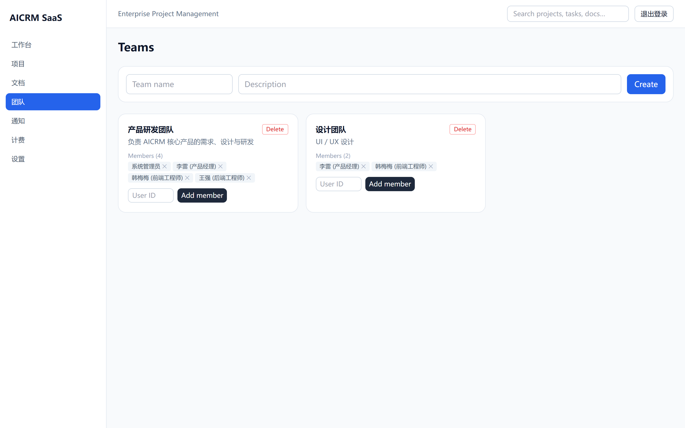 |

| Notifications / 通知 | Billing / 计费 |
| --- | --- |
| 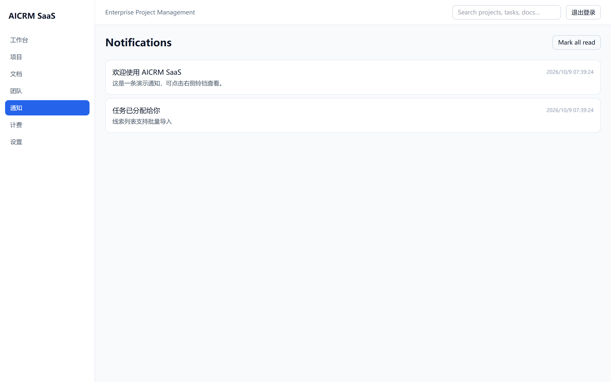 | 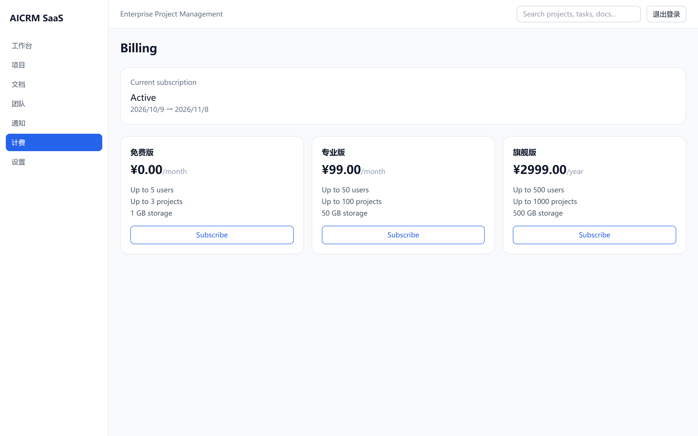 |

| User management / 用户管理 | Audit log / 审计日志 |
| --- | --- |
| 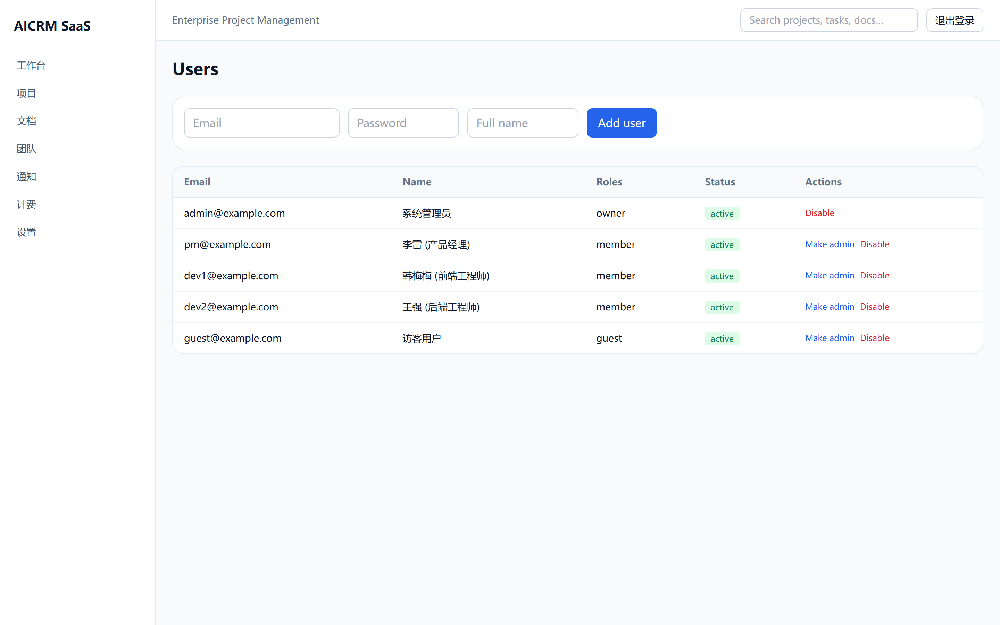 | 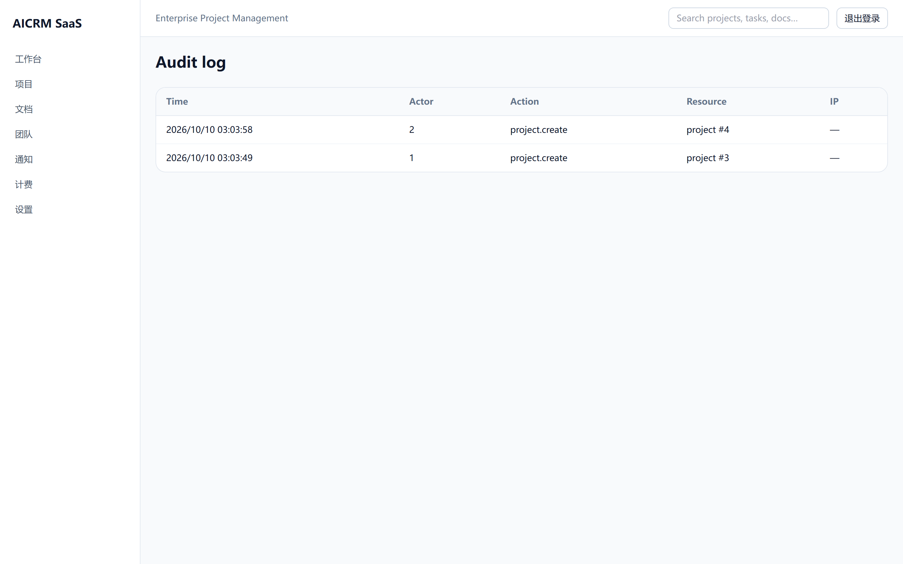 |

| Settings / 设置 |  |
| --- | --- |
| 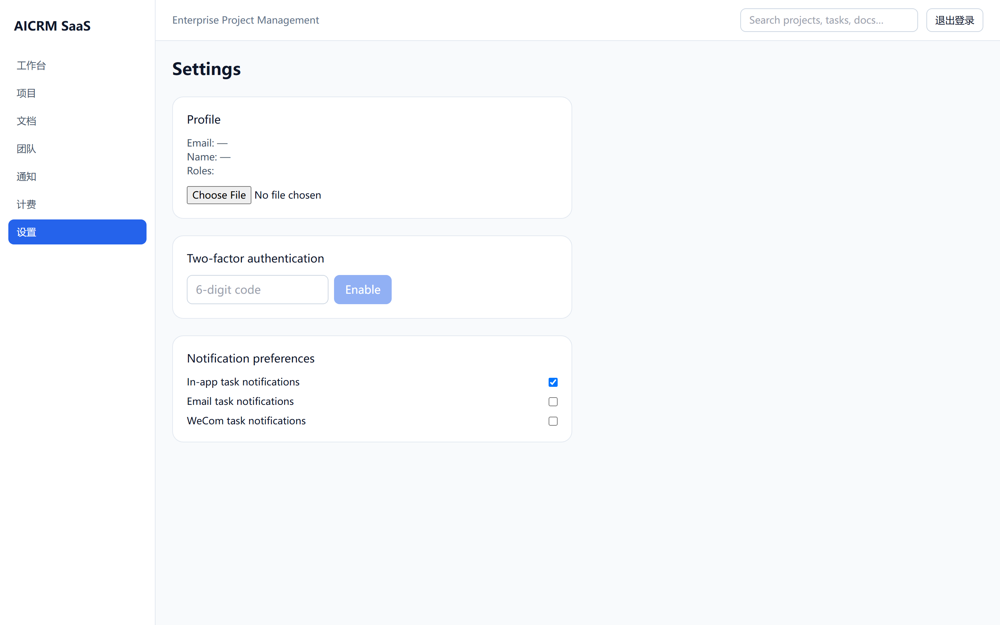 |  |

## Features
- Projects, kanban boards, tasks, comments, attachments, documents with version history.
- Real-time collaboration via WebSocket (board/task updates and notifications).
- Email + password with TOTP 2FA, WeCom SSO, RBAC roles and granular permissions.
- Notifications: in-app, email (SMTP), and WeCom app messages.
- Subscription billing abstraction with Alipay and WeChat Pay V3 callbacks; signed license activation.
- Audit logs, structured JSON logs, Prometheus `/metrics`, `/healthz`, `/readyz`, rate limiting.
- Chinese + English UI; Docker Compose single-package delivery with `deploy/upgrade.sh` online upgrade.

## Demo data / 演示数据

Want to try it immediately? Seed a rich Chinese demo dataset:

```bash
cd backend
python -m app.cli seed-demo          # idempotent; add --reset to wipe first
```

Then log in (see [docs/demo.md](docs/demo.md) for the full guide):

| Role | Email | Password |
| --- | --- | --- |
| Superuser | `admin@example.com` | `Admin123456!` |
| Member (PM/dev) | `pm@example.com`, `dev1@example.com`, `dev2@example.com` | `Demo123456!` |
| Guest | `guest@example.com` | `Demo123456!` |

Set `SEED_DEMO=true` to auto-seed on startup (the login page then shows a one-click fill button).

## Quickstart
See [docs/demo.md](docs/demo.md), [docs/deployment.md](docs/deployment.md) and [docs/architecture.md](docs/architecture.md).

```bash
# Backend tests
cd backend
python -m venv .venv && .venv\Scripts\activate
pip install -r requirements.txt
pytest

# Frontend build
cd frontend
npm install
npm run build
```

## Layout
- `backend/` — FastAPI application, tests, Alembic migrations.
- `frontend/` — React/Vite/Tailwind SPA.
- `deploy/` — upgrade automation.
- `docs/` — architecture and deployment notes, plus `docs/screenshots/` used by this README.
- `scripts/` — developer tooling (README screenshot capture).
